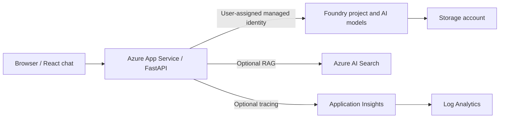
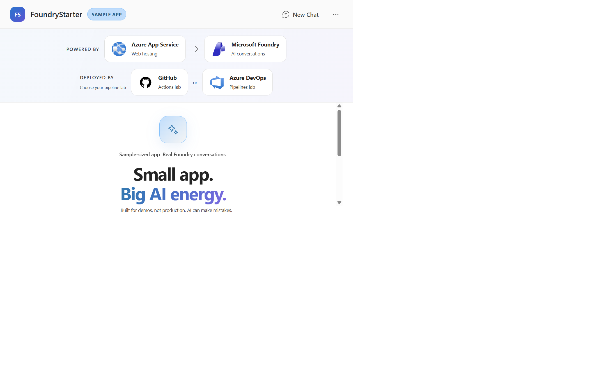

<!-- YAML front-matter schema: https://review.learn.microsoft.com/en-us/help/contribute/samples/process/onboarding?branch=main#supported-metadata-fields-for-readmemd -->

# FoundryStarter

A streaming AI chat application using Microsoft Foundry, FastAPI, React, and Azure
App Service, with optional RAG, tracing, and two-stage CI/CD.

This is an App Service adaptation of [Azure-Samples/get-started-with-ai-chat](https://github.com/Azure-Samples/get-started-with-ai-chat).
The original React UI, FastAPI streaming chat, Foundry models, managed identity, optional RAG, and tracing are retained.
The chat interface adds a visible sample-app badge, playful welcome copy, and a
"Powered by" App Service-to-Foundry architecture strip. A "Deployed by" section
links to the alternative GitHub Actions and Azure DevOps pipeline labs for
DevOps course learners. Both options are shown; the UI does not detect which
pipeline deployed the app. Learners enter their own questions without preset prompts.
The official product icons are used as educational architecture/integration
illustrations under [Microsoft's icon terms](https://learn.microsoft.com/azure/architecture/icons/)
and [GitHub's logo guidelines](https://brand.github.com/foundations/logo);
see the [icon notice](src/api/static/assets/technology-icons/NOTICE.txt).
Application hosting uses the built-in Linux Python 3.13 runtime and ZIP deployment: no Docker build,
custom container image, Azure Container Apps environment, or Azure Container Registry is required.
App Service manages its runtime internally; this is not a Windows/IIS deployment.

<div style="text-align:center;">

[**SOLUTION OVERVIEW**](#solution-overview) \| [**GETTING STARTED**](#getting-started) \| [**LOCAL DEVELOPMENT**](#local-development) \| [**RESOURCE CLEAN-UP**](#resource-clean-up) \|  [**GUIDANCE**](#guidance) \| [**DISCLAIMERS**](#disclaimers)

</div>

**Note**: With any AI solutions you create using these templates, you are responsible for assessing all associated risks, and for complying with all applicable laws and safety standards. Learn more in the transparency documents for [Azure AI Search](https://learn.microsoft.com/en-us/azure/ai-foundry/responsible-ai/search/transparency-note?tabs=enrichment). 

## Solution Overview

This solution deploys a web-based chat application with AI capabilities running in Azure App Service.

The application leverages Microsoft Foundry projects and Foundry Tools to provide intelligent chat functionality. It supports both direct AI model interaction and Retrieval-Augmented Generation (RAG) using Azure AI Search for knowledge retrieval from uploaded files, enabling it to generate responses with citations. The solution also includes built-in monitoring capabilities with tracing to ensure easier troubleshooting and optimized performance.

This solution creates an Microsoft Foundry project and Foundry Tools. More details about the resources can be found in the [resources](#resources) documentation. There are options to enable RAG, logging, tracing, and monitoring.

Instructions are provided for deployment through GitHub Codespaces, VS Code Dev Containers, and your local development environment.

### Solution Architecture



The app code runs on a Linux App Service plan (B1 by default) with Gunicorn and Uvicorn.
The prepackage hook builds React and stages the backend, sample data, and static assets;
App Service's Oryx build installs Python dependencies from `requirements.txt`.

### Key Features

• **[Knowledge Retrieval](./docs/RAG.md)**: The AI chat application supports Retrieval-Augmented Generation (RAG) using Azure AI Search to retrieve knowledge from uploaded files, enabling contextual responses with citations.

• **[Customizable AI Model Deployment](./docs/deploy_customization.md#customizing-model-deployments)**: The solution allows users to configure and deploy AI models, such as gpt-5.4-mini, with options to adjust model capacity, deployment configurations, and knowledge retrieval methods.

• **[Built-in Monitoring and Tracing](./docs/other_features.md#tracing-and-monitoring)**: Integrated monitoring capabilities, including Azure Monitor and Application Insights, enable tracing and logging for easier troubleshooting and performance optimization.

• **[Flexible Deployment Options](./docs/deployment.md)**: The solution supports deployment through GitHub Codespaces, VS Code Dev Containers, or local environments, providing flexibility for different development workflows.

The sample chat welcome screen highlights its hosting, AI integration, and the
two alternative deployment labs:



**WARNING**: This template, the application code and configuration it contains, has been built to showcase Microsoft Azure specific services and tools. We strongly advise our customers not to make this code part of their production environments without implementing or enabling additional security features.  

For a more comprehensive list of best practices and security recommendations for Intelligent Applications, [visit our official documentation](https://learn.microsoft.com/en-us/azure/ai-foundry/).
        
## Getting Started

### Deploy this App Service version from your local folder

Install Python 3.13, Node.js 22 LTS (with npm), Azure CLI, Azure Developer CLI, and PowerShell 7 on Windows.
No Docker or global pnpm installation is needed. To start from a fresh clone:

```powershell
git clone https://github.com/petender/FoundryStarter.git
cd FoundryStarter
azd auth login
azd up
```

Choose your subscription and a region with model quota and App Service support.
Open the HTTPS endpoint printed by `azd`. For optional RAG, set
`azd env set USE_AZURE_AI_SEARCH_SERVICE true` before deployment.
See the [deployment guide](docs/deployment.md) for prerequisites, authentication, and local execution.

> Upstream Codespaces/Dev Containers buttons and the inherited Copilot `/up` skill
> describe the **original Container Apps sample**, not this adaptation. Use this
> local folder and `azd up` to deploy the App Service version; a dev container is optional tooling only.


**After deployment, try these [sample questions](./docs/sample_questions.md) to test your web application.**

## Local Development

For automated deployment, see [two-stage Azure DevOps and GitHub Actions CI/CD without azd](docs/cicd.md).

For developers who want to run the application locally or customize the chat application:

• **[Local Development Guide](./docs/deployment.md#local-development)** - Set up a local development environment, customize the frontend and backend, modify AI model configurations, and test your changes locally.

This guide covers:

• Environment setup and prerequisites
• Running the development server locally  
• Frontend customization and backend communication
• AI model and RAG configuration
• Embedding file upload
• Testing and debugging your application

- **[Tracing and Monitoring](./docs/other_features.md#tracing-and-monitoring)** - View console logs in Azure portal and App Insights tracing in Microsoft Foundry for debugging and performance monitoring.

## Resource Clean-up

To prevent incurring unnecessary charges, it's important to clean up your Azure resources after completing your work with the application.

- **When to Clean Up:**
  - After you have finished testing or demonstrating the application.
  - If the application is no longer needed or you have transitioned to a different project or environment.
  - When you have completed development and are ready to decommission the application.

- **Deleting Resources:**
  To delete all associated resources and shut down the application, execute the following command:
  
    ```bash
    azd down
    ```

    Please note that this process may take up to 20 minutes to complete.

⚠️ Alternatively, you can delete the resource group directly from the Azure Portal to clean up resources.

## Guidance

### Costs

Pricing varies per region and usage, so it isn't possible to predict exact costs for your usage.
The majority of the Azure resources used in this infrastructure are on usage-based pricing tiers.
The App Service plan has a fixed cost even while the web app is idle; B1 does not scale to zero.

You can try the [Azure pricing calculator](https://azure.microsoft.com/en-us/pricing/calculator) for the resources:

* Microsoft Foundry: Free tier. [Pricing](https://azure.microsoft.com/pricing/details/ai-studio/)
* Azure AI Search: Standard tier, S1. Pricing is based on the number of documents and operations. [Pricing](https://azure.microsoft.com/pricing/details/search/)
* Azure Storage Account: Standard tier, LRS. Pricing is based on storage and operations. [Pricing](https://azure.microsoft.com/pricing/details/storage/blobs/)
* Foundry Tools: S0 tier, defaults to gpt-5.4-mini (2026-03-17) and optional text-embedding-3-small models. Pricing is based on token count. [Pricing](https://azure.microsoft.com/pricing/details/cognitive-services/)
* Azure App Service: Linux B1 plan by default, billed while provisioned. [Pricing](https://azure.microsoft.com/pricing/details/app-service/linux/)
* Log analytics: Pay-as-you-go tier. Costs based on data ingested. [Pricing](https://azure.microsoft.com/pricing/details/monitor/)

⚠️ To avoid unnecessary costs, remember to take down your app if it's no longer in use,
either by deleting the resource group in the Portal or running `azd down`.

### Security guidelines

This template also uses [Managed Identity](https://learn.microsoft.com/entra/identity/managed-identities-azure-resources/overview) for local development and deployment.

To ensure continued best practices in your own repository, we recommend that anyone creating solutions based on our templates ensure that the [Github secret scanning](https://docs.github.com/code-security/secret-scanning/about-secret-scanning) setting is enabled.

You may want to consider additional security measures, such as:

- Enabling Microsoft Defender for Cloud to [secure your Azure resources](https://learn.microsoft.com/azure/defender-for-cloud/).
- Protecting App Service with [access restrictions](https://learn.microsoft.com/azure/app-service/app-service-ip-restrictions) and [Microsoft Entra authentication](docs/azure_app_service_auth_setup.md).

> **Important Security Notice** <br/>
This template, the application code and configuration it contains, has been built to showcase Microsoft Azure specific services and tools. We strongly advise our customers not to make this code part of their production environments without implementing or enabling additional security features.  <br/><br/>
For a more comprehensive list of best practices and security recommendations for Intelligent Applications, [visit our official documentation](https://learn.microsoft.com/en-us/azure/ai-foundry/).

### Resources

This template creates everything you need to get started with Microsoft Foundry:

| Resource | Description |
|----------|-------------|
| [Azure AI Project](https://learn.microsoft.com/azure/ai-studio/how-to/create-projects) | Provides a collaborative workspace for AI development with access to models, data, and compute resources |
| [Azure OpenAI Service](https://learn.microsoft.com/azure/ai-services/openai/) | Powers the AI agents for conversational AI and intelligent search capabilities. The default chat model is gpt-5.4-mini (2026-03-17), but other Azure AI models can be specified per the [documentation](docs/deploy_customization.md#customizing-model-deployments) |
| [Azure App Service](https://learn.microsoft.com/azure/app-service/) | Hosts the Python backend and React assets using the built-in runtime on a Linux App Service plan |
| [Storage Account](https://learn.microsoft.com/azure/storage/blobs/) | Provides blob storage for application data and file uploads |
| [AI Search Service](https://learn.microsoft.com/azure/search/) | *Optional* - Enables hybrid search capabilities combining semantic and vector search |
| [Application Insights](https://learn.microsoft.com/azure/azure-monitor/app/app-insights-overview) | *Optional* - Provides application performance monitoring, logging, and telemetry for debugging and optimization |
| [Log Analytics Workspace](https://learn.microsoft.com/azure/azure-monitor/logs/log-analytics-workspace-overview) | *Optional* - Collects and analyzes telemetry data for monitoring and troubleshooting |

## Disclaimers

To the extent that the Software includes components or code used in or derived from Microsoft products or services, including without limitation Microsoft Azure Services (collectively, “Microsoft Products and Services”), you must also comply with the Product Terms applicable to such Microsoft Products and Services. You acknowledge and agree that the license governing the Software does not grant you a license or other right to use Microsoft Products and Services. Nothing in the license or this ReadMe file will serve to supersede, amend, terminate or modify any terms in the Product Terms for any Microsoft Products and Services.

You must also comply with all domestic and international export laws and regulations that apply to the Software, which include restrictions on destinations, end users, and end use. For further information on export restrictions, visit <https://aka.ms/exporting>.

You acknowledge that the Software and Microsoft Products and Services (1) are not designed, intended or made available as a medical device(s), and (2) are not designed or intended to be a substitute for professional medical advice, diagnosis, treatment, or judgment and should not be used to replace or as a substitute for professional medical advice, diagnosis, treatment, or judgment. Customer is solely responsible for displaying and/or obtaining appropriate consents, warnings, disclaimers, and acknowledgements to end users of Customer’s implementation of the Online Services.

You acknowledge the Software is not subject to SOC 1 and SOC 2 compliance audits. No Microsoft technology, nor any of its component technologies, including the Software, is intended or made available as a substitute for the professional advice, opinion, or judgement of a certified financial services professional. Do not use the Software to replace, substitute, or provide professional financial advice or judgment.  

BY ACCESSING OR USING THE SOFTWARE, YOU ACKNOWLEDGE THAT THE SOFTWARE IS NOT DESIGNED OR INTENDED TO SUPPORT ANY USE IN WHICH A SERVICE INTERRUPTION, DEFECT, ERROR, OR OTHER FAILURE OF THE SOFTWARE COULD RESULT IN THE DEATH OR SERIOUS BODILY INJURY OF ANY PERSON OR IN PHYSICAL OR ENVIRONMENTAL DAMAGE (COLLECTIVELY, “HIGH-RISK USE”), AND THAT YOU WILL ENSURE THAT, IN THE EVENT OF ANY INTERRUPTION, DEFECT, ERROR, OR OTHER FAILURE OF THE SOFTWARE, THE SAFETY OF PEOPLE, PROPERTY, AND THE ENVIRONMENT ARE NOT REDUCED BELOW A LEVEL THAT IS REASONABLY, APPROPRIATE, AND LEGAL, WHETHER IN GENERAL OR IN A SPECIFIC INDUSTRY. BY ACCESSING THE SOFTWARE, YOU FURTHER ACKNOWLEDGE THAT YOUR HIGH-RISK USE OF THE SOFTWARE IS AT YOUR OWN RISK.
