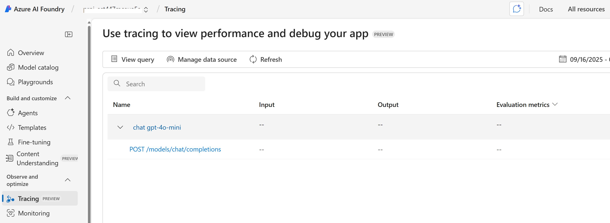

# Other Features

## Tracing and Monitoring

```shell
azd env set ENABLE_AZURE_MONITOR_TRACING true
azd provision
azd deploy
```

You can view console logs in the Azure portal. You can get the link to the resource group with the azd tool:

```shell
azd show
```

Or if you want to navigate from the Azure portal main page, select your resource group from the 'Recent' list, or by clicking the 'Resource groups' and searching your resource group there.

After accessing your resource group in Azure portal, choose the App Service web app.
Open **Monitoring > Log stream** to view Gunicorn/Uvicorn and application console logs.
For dependency installation failures, use **Deployment Center > Logs**.
App Service filesystem logging is enabled for this demo.

You can view the App Insights tracing in Microsoft Foundry. Select your project on the Microsoft Foundry page and then click 'Tracing'. 

